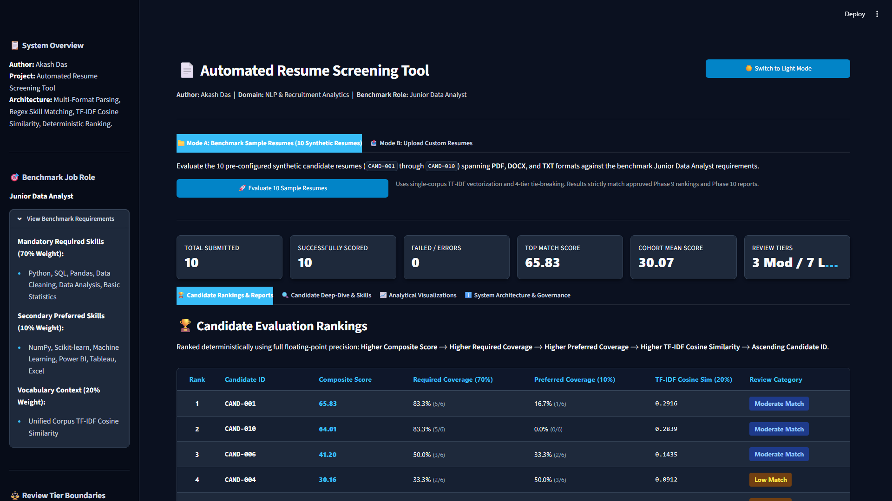
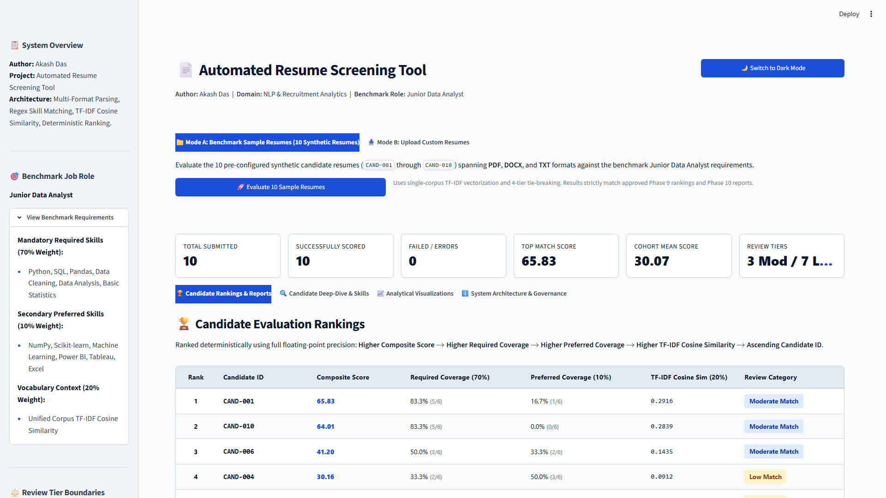
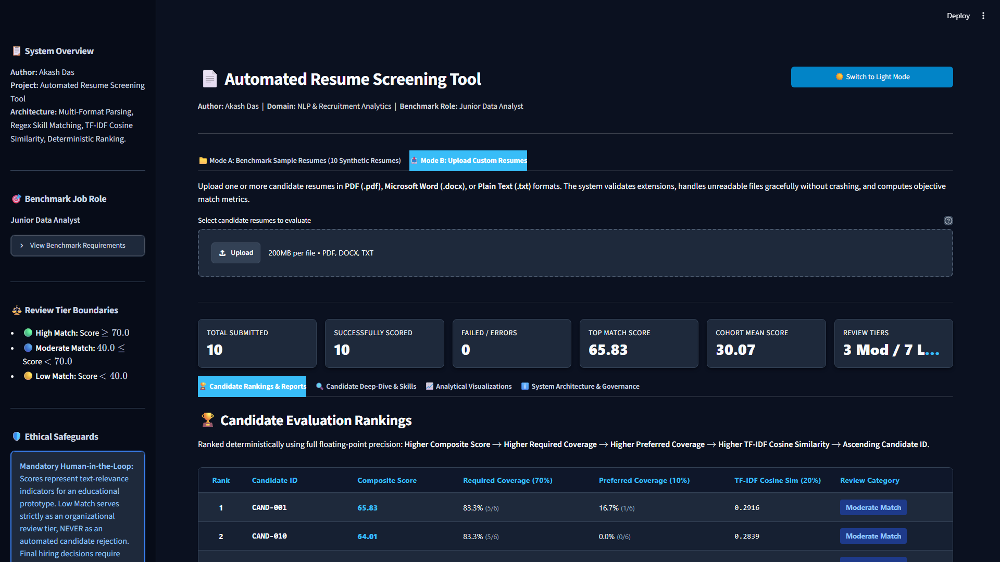
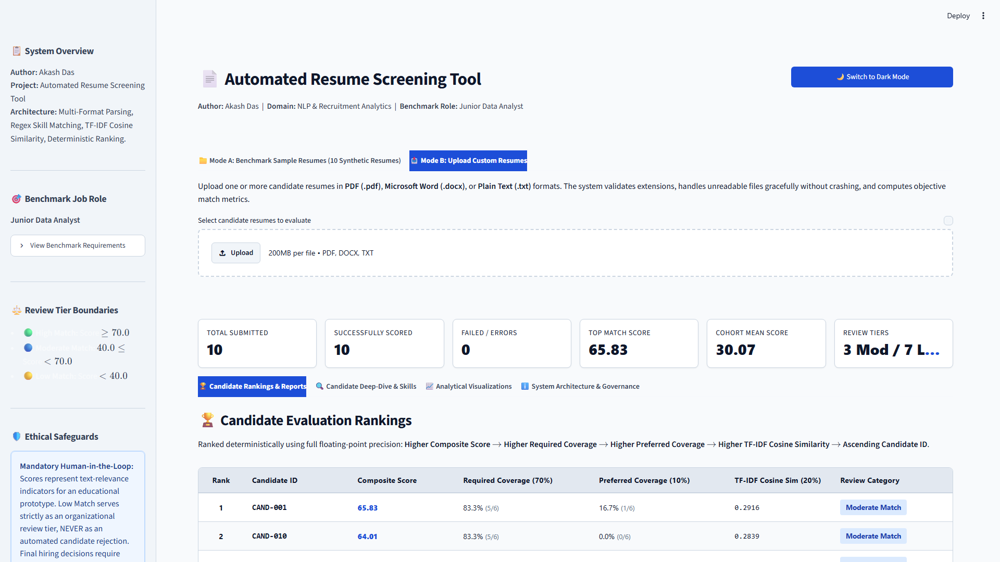

# Automated Resume Screening Tool

**Version 2.0 | Enhanced Implementation**

[](https://www.python.org/)
[](https://streamlit.io/)
[](https://scikit-learn.org/)
[](https://pandas.pydata.org/)
[](https://pymupdf.readthedocs.io/)
[](tests/)
[](LICENSE)
[](https://www.microsoft.com/windows)
[](requirements.txt)

An explainable Natural Language Processing application for parsing multi-format resumes, matching domain skills against benchmark job descriptions, calculating composite relevance scores, and deterministically ranking candidates with full transparency and human-in-the-loop governance.

---

## Table of Contents

1. [Project Overview](#1-project-overview)
   - [Project Evolution: Version 1.0 to Version 2.0](#project-evolution-version-10-to-version-20)
2. [Problem Statement](#2-problem-statement)
3. [Project Objectives](#3-project-objectives)
4. [Key Features](#4-key-features)
5. [Technology Stack](#5-technology-stack)
6. [System Architecture](#6-system-architecture)
7. [Resume Screening Workflow](#7-resume-screening-workflow)
8. [Resume Parsing and Text Extraction](#8-resume-parsing-and-text-extraction)
9. [Text Cleaning and Personal-Identifier Sanitization](#9-text-cleaning-and-personal-identifier-sanitization)
10. [Skill Extraction and Matching](#10-skill-extraction-and-matching)
11. [TF-IDF Cosine Similarity](#11-tf-idf-cosine-similarity)
12. [Composite Scoring Methodology](#12-composite-scoring-methodology)
13. [Candidate Ranking and Tie-Breaking](#13-candidate-ranking-and-tie-breaking)
14. [Human Review Categories](#14-human-review-categories)
15. [Benchmark Job Description](#15-benchmark-job-description)
16. [Synthetic Dataset Description](#16-synthetic-dataset-description)
17. [Streamlit Dashboard](#17-streamlit-dashboard)
18. [Dark Mode and Light Mode](#18-dark-mode-and-light-mode)
19. [Dashboard Screenshots](#19-dashboard-screenshots)
20. [CSV and Excel Report Generation](#20-csv-and-excel-report-generation)
21. [Project Directory Structure](#21-project-directory-structure)
22. [Installation Instructions](#22-installation-instructions)
23. [Virtual Environment Setup](#23-virtual-environment-setup)
24. [Dependency Installation](#24-dependency-installation)
25. [Application Execution](#25-application-execution)
26. [Running Tests](#26-running-tests)
27. [Example Workflow](#27-example-workflow)
28. [Privacy and Ethical Safeguards](#28-privacy-and-ethical-safeguards)
29. [Limitations](#29-limitations)
30. [Future Improvements](#30-future-improvements)
31. [Contributing Guidelines](#31-contributing-guidelines)
32. [License](#32-license)
33. [Author Information](#33-author-information)

---

## 1. Project Overview

The Automated Resume Screening Tool is a deterministic Natural Language Processing (NLP) system developed in Python. It evaluates, scores, and organizes candidate resumes against structured job requirements without relying on opaque deep-learning models or generative language model APIs.

The system ingests resume documents across three primary file formats (PDF, DOCX, and TXT), extracts textual content, normalizes vocabulary while strictly preserving domain-specific technical terminology, matches canonical skills using word-boundary regular expressions, calculates vocabulary alignment through Term Frequency - Inverse Document Frequency (TF-IDF) cosine similarity, and applies a weighted scoring model. 

Every candidate score produced by the application is directly traceable to explicit textual evidence. The application does not attempt to evaluate general human intelligence, cultural suitability, or predict future workplace success. It functions strictly as an objective, auditable decision-support aid for human recruitment teams.

### Project Evolution: Version 1.0 to Version 2.0

This project represents Version 2.0 of the Automated Resume Screening Tool, building directly upon the foundational architecture originally created and published by Akash Das in 2025:

- **Original Version 1.0 Repository:** [https://github.com/AkashDas-AI/Automated-Resume-Screening-Tool](https://github.com/AkashDas-AI/Automated-Resume-Screening-Tool)

#### Motivation for Version 2.0

The original Version 1.0 established the foundational concept of an automated NLP screening workflow: extracting resume text, matching keywords, calculating TF-IDF similarity, and displaying results in an interactive interface. While successful as an initial prototype, rigorous technical evaluation revealed key opportunities for engineering refinement:

1. **Deterministic Scoring and Reproducibility:** Version 1.0 relied on heuristic scoring weights (40% similarity, 40% skill match, 20% experience) with arbitrary penalties (0.01 deduction per missing skill). Version 2.0 introduces a mathematically calibrated 70/10/20 linear composite model bounded strictly between 0.0 and 100.0 with zero hidden deductions.
2. **Deterministic Tie-Breaking:** Version 1.0 lacked formal resolution for tied candidates, relying on arbitrary dataframe index ordering. Version 2.0 establishes a deterministic 4-tier tie-breaking algorithm evaluated down to $10^{-6}$ precision.
3. **Token Preservation and Ingestion Robustness:** Version 1.0 used basic regex cleaning that stripped punctuation, inadvertently fragmenting programming tokens like `C++`, `C#`, and `.NET`. Version 2.0 implements token-shielded preprocessing with negative lookahead and lookbehind protections, alongside multi-format document extraction across PDF, DOCX, and TXT files.
4. **Ethical Safeguards and Privacy:** Version 1.0 categorized candidates into a "Rejected" tier, simulating automated exclusion. Version 2.0 strictly eliminates automated rejection in favor of human review tiers (`Moderate Match`, `Low Match`), and enforces complete exclusion of candidate Personally Identifiable Information (PII) from algorithmic processing and reports.
5. **Architectural Decoupling:** Version 1.0 coupled pipeline execution to local SQLite database tables (`screening.db`). Version 2.0 adopts a decoupled, in-memory processing architecture for document ingestion, scoring, and on-demand report exports, eliminating local database schema dependencies while using Streamlit session state strictly for non-recomputational UI caching.
6. **Comprehensive Automated Testing:** Version 1.0 contained no automated test suite. Version 2.0 is validated by an automated test suite of 188 unit, integration, and regression tests maintaining a 100% pass rate.
7. **User Interface and Contrast Standards:** Version 1.0 featured a single-theme interface with default Streamlit styling. Version 2.0 delivers an interactive Streamlit dashboard featuring Dark and Light modes engineered to satisfy WCAG 2.2 AA color contrast thresholds ($\ge 4.5:1$), multi-file upload with per-file error isolation, and four analytical navigation tabs.

#### Verified Architectural and Technical Comparison

| Dimension | Version 1.0 (Baseline Implementation) | Version 2.0 (Enhanced Implementation) |
|---|---|---|
| **System Architecture** | Procedural script pipeline with SQLite database (`db/screening.db`) persistence. | Modular, decoupled pipeline with in-memory data processing and UI session caching. |
| **Document Ingestion** | Basic `pdfplumber`/`PyPDF2` and `python-docx` text extraction primarily tested on `.txt`. | Multi-format document parser (`PyMuPDF`, `python-docx`, UTF-8 text) with per-file error and corruption handling. |
| **Text Preprocessing** | Standard regex punctuation removal without technical token preservation. | Token-safe multi-stage preprocessor protecting `C++`, `C#`, `.NET`, `Node.js`, `CI/CD`, `scikit-learn`, and `Power BI`. |
| **Skill Extraction** | Fuzzy string matching (`rapidfuzz`) and simple dictionary keyword scans. | Contextual regex pattern matching (`\b<skill>\b`) with taxonomy aliases and $\pm 50$-character evidence extraction. |
| **TF-IDF Vectorization** | Independent TF-IDF vectorization with potential vocabulary divergence. | Unified joint-corpus vectorization ($N = 1 + M$ documents) with sublinear term-frequency scaling ($1 + \log(tf)$). |
| **Scoring Formula** | Heuristic formula: $40\% \text{ Sim} + 40\% \text{ Skills} + 20\% \text{ Exp} - \text{Penalties}$. | Calibrated linear formula: $70\% \text{ Req} + 10\% \text{ Pref} + 20\% \text{ Sim}$ bounded strictly in $[0.0, 100.0]$. |
| **Tie-Breaking Engine** | None; default pandas index-order resolution. | Deterministic 4-tier tie-breaking engine resolved to $10^{-6}$ precision with candidate ID fallback. |
| **Ethical Governance** | Automated candidate rejection ("Rejected" category). | Strict human-in-the-loop review tiers; automated candidate rejection prohibited; PII stripped from scoring. |
| **Reporting & Export** | Disk-bound CSV and Excel report exports. | In-memory UTF-8 CSV streaming and multi-worksheet formatted Excel workbooks via `openpyxl` with metadata tabs. |
| **Visual Analytics** | Static Matplotlib charts and basic Plotly plots. | 7 static Matplotlib analytical figures with dual Dark/Light palette adaptability. |
| **Dashboard Interface** | Basic Streamlit interface with default styling. | Interactive Streamlit dashboard featuring Dark/Light theme switching, WCAG 2.2 AA color contrast alignment, and multi-file uploads. |
| **Automated Testing** | 0 automated tests (no `tests/` directory). | 188 automated unit, integration, and regression tests in `tests/` (100% passing across 8 test modules). |
| **Technical Documentation** | Single root README. | 33-section root README plus 9 comprehensive public technical guides in `docs/` and 4 visual assets in `images/`. |

---

## 2. Problem Statement

Recruitment professionals frequently evaluate hundreds or thousands of resumes for a single job requisition. Manual review of large resume volumes introduces several operational challenges:

1. Time Inefficiency: Manual review requires significant labor hours, leading to prolonged hiring cycles.
2. Evaluator Fatigue and Inconsistency: Human recruiters apply shifting evaluation standards as fatigue accumulates across large candidate batches.
3. Lack of Auditability: Traditional manual screening rarely produces a structured, reproducible mathematical audit trail of why a candidate was shortlisted or passed over.
4. Black-Box AI Risks: Many commercial recruitment systems utilize opaque neural networks or unvetted large language models. These systems risk candidate hallucination, uncontrolled demographic bias, and vulnerability to prompt injection attacks, creating substantial compliance and legal risks under employment fairness regulations.

---

## 3. Project Objectives

The primary engineering objectives of this project are:

1. Deterministic Reproducibility: Ensure identical inputs always yield identical scores, rankings, and tie-breaking outcomes across repeated executions.
2. Complete Mathematical Explainability: Every score is composed of verifiable mathematical sub-metrics: Mandatory Required Skills (70%), Secondary Preferred Skills (10%), and Vocabulary Cosine Similarity (20%).
3. Multi-Format Document Ingestion: Robustly extract text from Adobe PDF, Microsoft Word DOCX, and Plain Text files with comprehensive error handling for corrupted or empty buffers.
4. Privacy by Design: Exclude Personally Identifiable Information (PII) from scoring algorithms, internal feature representations, and public audit reports.
5. Interactive Web Interface: Provide an interactive, responsive Streamlit dashboard featuring persistent theme management (Dark and Light modes) engineered to satisfy WCAG 2.2 AA color contrast thresholds.
6. Comprehensive Quality Assurance: Validate all system components through an automated test suite of 188 unit, integration, and regression tests.

---

## 4. Key Features

- Multi-Format Parser: Extracts clean text from PDF (PyMuPDF), DOCX (python-docx), and TXT documents.
- Token-Safe Preprocessor: Cleans noise while safeguarding technical tokens such as C++, C#, .NET, Node.js, Scikit-learn, and Power BI.
- Contextual Skill Extractor: Detects skills using word-boundary patterns (`\b`) and extracts verifiable context windows (+/- 50 characters) around every detection.
- Unified Corpus Vectorizer: Fits a single joint TF-IDF vocabulary across the job description and candidate cohort, ensuring consistent IDF weighting.
- Sublinear Term Frequency Scaling: Mitigates keyword stuffing by applying logarithmic term frequency dampening ($1 + \log(tf)$).
- Multi-Factor Composite Scoring: Computes weighted scores on a transparent 0 to 100 scale.
- Deterministic 4-Tier Tie-Breaking: Resolves identical scores using a sequential hierarchy of sub-metrics with precision down to $10^{-6}$.
- Human Review Prioritization Tiers: Categorizes candidates into High Match, Moderate Match, and Low Match groups for review triage.
- Dual Operational Modes: Mode A for instant benchmark evaluation of 10 synthetic candidates; Mode B for dynamic drag-and-drop file uploads.
- Audit-Ready Exporters: Streams in-memory CSV files and multi-worksheet formatted Excel workbooks (`.xlsx`) using openpyxl.
- Theme-Aware Dashboard: Supports dynamic toggling between Dark Mode and Light Mode with zero data loss or pipeline recomputation.
- Strict Candidate Privacy: Uses canonical candidate IDs (`CAND-001`), completely omitting personal names, phone numbers, and email addresses.

---

## 5. Technology Stack

| Layer | Component | Version | Technical Purpose |
|---|---|---|---|
| Language | Python | 3.11.0 | Base runtime environment |
| UI Framework | Streamlit | 1.67.0 | Web interface and interactive controls |
| Machine Learning | scikit-learn | 1.9.1 | TF-IDF vectorization and cosine similarity |
| Data Manipulation | pandas | 3.1.1 | Dataframe manipulation and cohort transformations |
| Scientific Computing | numpy | 2.4.6 | Numerical operations and array manipulation |
| PDF Extraction | PyMuPDF (fitz) | 2.1 | Fast C-based PDF text parsing |
| Word Extraction | python-docx | 1.2.0 | Microsoft Word document paragraph and table extraction |
| Excel Generation | openpyxl | 3.1.5 | Formatted multi-tab spreadsheet generation |
| Data Visualization | matplotlib | 3.11.2 | Publication-grade chart generation (Agg non-interactive backend) |
| Testing Framework | pytest | 9.2.0 | Automated unit, integration, and regression testing |

---

## 6. System Architecture

The project utilizes a modular layered architecture. The presentation tier (`app.py`) is decoupled from the core NLP logic through a dedicated service layer (`src/dashboard_service.py`).

```text
+-------------------------------------------------------------------------------+
|                       PRESENTATION & GOVERNANCE LAYER                         |
|   app.py (Streamlit Web Dashboard)  |  src/theme_manager.py (WCAG 2.2 AA CSS) |
|   src/dashboard_charts.py (Responsive Theme-Aware Matplotlib Renderers)        |
+-------------------------------------------------------------------------------+
                                      |
                                      v
+-------------------------------------------------------------------------------+
|                             SERVICE LAYER                                     |
|   src/dashboard_service.py (Batch Orchestration, Uploads, In-Memory Streams)  |
+-------------------------------------------------------------------------------+
                                      |
                                      v
+-------------------------------------------------------------------------------+
|                          CORE NLP & SCORING PIPELINE                          |
|  1. Ingestion: src/resume_parser.py (PDF, DOCX, TXT Stream Decoders)          |
|  2. Hygiene:   src/text_cleaner.py (Sanitization & Tech Token Protection)     |
|  3. Skills:    src/skill_extractor.py (Regex Boundaries & Context Slicing)    |
|  4. Vectors:   src/similarity.py (Single-Corpus TF-IDF & Cosine Sim)          |
|  5. Scoring:   src/scoring.py (70% Req / 10% Pref / 20% Similarity)           |
|  6. Ranking:   src/ranking.py (4-Tier Tie-Breaking Determinism)               |
|  7. Reporting: src/report_generator.py (CSV & Multi-Sheet Formatted Excel)    |
+-------------------------------------------------------------------------------+
```

---

## 7. Resume Screening Workflow

The end-to-end evaluation follows a structured, deterministic lifecycle:

1. Input Submission: The user chooses Mode A (pre-configured benchmark cohort) or Mode B (custom multi-file upload).
2. Format Validation: File extensions are checked against `[".pdf", ".docx", ".txt"]`. Files with 0-byte sizes or corrupted byte headers are cataloged in an error registry without halting execution.
3. Text Extraction: Text streams are parsed in memory using PyMuPDF, python-docx, or the built-in UTF-8 decoder.
4. Normalization: Text is lowercased, whitespace is collapsed, and technical tokens are preserved through lookahead regexes.
5. Skill Extraction: Normalized text is scanned against the 12-skill taxonomy. Detections and surrounding context windows (+/- 50 characters) are captured.
6. Unified Vectorization: The job description and all resumes are vectorized together into a single TF-IDF matrix ($N = 1 + M$).
7. Mathematical Scoring: Composite scores (0.0 to 100.0) are calculated via the 70/10/20 formula.
8. Deterministic Ranking: Candidates are sorted using a 4-tier tie-breaking algorithm and assigned sequential ranks.
9. Dashboard Rendering: The interface displays KPI cards, high-contrast tables, context evidence accordions, and analytical visualizations.
10. Report Export: Recruiter downloads audit-ready CSV or formatted Excel workbooks directly from browser buttons.

---

## 8. Resume Parsing and Text Extraction

Document ingestion is handled by `src/resume_parser.py`. The module accepts both filesystem paths and in-memory `io.BytesIO` streams.

### Format-Specific Parsing Engines
- PDF Extraction (`extract_text_from_pdf`): Powered by `PyMuPDF` (`fitz.open()`). Iterates over document pages, capturing structured text while filtering out font encoding anomalies and non-text artifacts.
- Word Document Extraction (`extract_text_from_docx`): Powered by `python-docx` (`docx.Document()`). Reads text across paragraphs and iterates through table cells to capture structured resume data.
- Plain Text Extraction (`extract_text_from_txt`): Decodes text streams using UTF-8 encoding with an automatic Latin-1 fallback.

### Error Handling Hierarchy
The parser implements a custom exception class: `FileExtractionError`.
- Empty Files: Any file buffer with a length of 0 bytes is rejected immediately.
- Corrupted Streams: Corrupted PDF or DOCX byte structures raise `FileExtractionError` and are captured by the service layer, ensuring partial batches continue processing.

---

## 9. Text Cleaning and Personal-Identifier Sanitization

Text sanitization is managed by `src/text_cleaner.py`. Cleaning prepares text for vectorization while protecting domain-specific technical vocabulary.

### Cleaning Operations
- Case Folding: Converts text to lowercase for canonical matching.
- Line Normalization: Converts Windows carriage returns (`\r\n`) to standard newlines (`\n`) and collapses multiple blank lines.
- Whitespace Compression: Replaces redundant tabs and multiple consecutive spaces with a single whitespace character.
- Noise Removal: Strips email addresses, hyperlink URLs, and unprintable ASCII control characters.

### Technical Keyword Protection
Standard NLP tokenizers often strip punctuation, corrupting technical keywords. The cleaner implements specialized regex lookahead protections to preserve:
- Programming Languages: `c++`, `c#`, `.net`, `asp.net`
- Web and Runtime Frameworks: `node.js`, `react.js`
- Data Science and DevOps Tools: `scikit-learn`, `power bi`, `ci/cd`

---

## 10. Skill Extraction and Matching

Skill detection is managed by `src/skill_extractor.py`. Skills are evaluated against the benchmark taxonomy defined in `junior_data_analyst_requirements.json`.

### Dual-Tier Taxonomy
- Mandatory Required Skills (6): Python, SQL, Pandas, Data Cleaning, Data Analysis, Basic Statistics.
- Secondary Preferred Skills (6): NumPy, Scikit-learn, Machine Learning, Power BI, Tableau, Excel.

### Word Boundary Matching
Every skill search pattern is compiled with strict word boundaries:
```python
pattern = r"\b" + re.escape(skill) + r"\b"
```
This prevents false-positive substring matches, such as preventing "java" from matching inside "javascript", or "c" from matching inside "cat".

### Context Window Extraction
For every detected skill, the extractor slices a window of +/- 50 characters around the matched offset. This provides recruiters with verifiable proof of how the skill was utilized within candidate project descriptions or employment histories.

---

## 11. TF-IDF Cosine Similarity

Vocabulary alignment is computed by `src/similarity.py`.

### Unified Corpus Construction
To guarantee identical Inverse Document Frequency (IDF) weights across candidates, the vectorizer is fit on a single unified corpus:
- Index 0: Normalized Job Description text.
- Indices 1 through M: Normalized candidate resume texts.
- Total Corpus Size: $N = 1 + M$ documents.

### Scikit-Learn Vectorizer Configuration
```python
TfidfVectorizer(
    ngram_range=(1, 2),
    sublinear_tf=True,
    norm="l2"
)
```
- N-gram Range `(1, 2)`: Captures single words and meaningful bigrams (e.g., "data analysis", "machine learning").
- Sublinear TF Scaling: Computes term frequency as $1 + \log(tf)$ for all $tf > 0$. This prevents candidates who repeat a keyword multiple times from dominating the similarity score.
- L2 Normalization: Normalizes document vectors to unit length, ensuring concise resumes are not penalized relative to verbose documents.

### Cosine Similarity Computation
Similarity is computed via the dot product of normalized vectors:
$$\text{Cosine Similarity}(\vec{u}, \vec{v}) = \frac{\vec{u} \cdot \vec{v}}{\|\vec{u}\|_2 \|\vec{v}\|_2}$$
The output is bounded strictly between 0.0 and 1.0.

> [!NOTE]
> TF-IDF cosine similarity measures textual vocabulary alignment between resume text and the benchmark job description. It serves strictly as a text-based relevance indicator and does not constitute proof or measurement of candidate job competence, problem-solving capability, or workplace proficiency.

---

## 12. Composite Scoring Methodology

Candidate scoring is implemented in `src/scoring.py`.

### Formula and Weights
The composite score is calculated using an authoritative weighted linear model:

$$\text{Composite Score} = (70.0 \times \text{Required Coverage}) + (10.0 \times \text{Preferred Coverage}) + (20.0 \times \text{TF-IDF Cosine Similarity})$$

| Component | Weight | Calculation Basis | Rationale |
|---|---:|---|---|
| Mandatory Required Skills | 70% | Matched Required / 6.0 | Core technical prerequisites essential for entry-level performance |
| Secondary Preferred Skills | 10% | Matched Preferred / 6.0 | Complementary tools that distinguish high-potential candidates |
| Vocabulary Context | 20% | TF-IDF Cosine Similarity | Broader domain terminology and context alignment |

The composite score is bounded strictly between 0.0 and 100.0 with full 64-bit floating-point precision.

---

## 13. Candidate Ranking and Tie-Breaking

Candidate sorting is managed by `src/ranking.py`. To eliminate non-deterministic sorting artifacts, candidates are sorted using Python's stable Timsort algorithm with a 5-element sorting key:

$$\text{Sort Key} = \Big(-\text{Composite Score},\; -\text{Required Coverage},\; -\text{Preferred Coverage},\; -\text{Cosine Similarity},\; \text{Candidate ID}\Big)$$

### Tie-Breaking Hierarchy
1. Primary: Descending Composite Match Score.
2. Level 1 Tie-Break: Higher Mandatory Required Skill Coverage (70% component).
3. Level 2 Tie-Break: Higher Secondary Preferred Skill Coverage (10% component).
4. Level 3 Tie-Break: Higher TF-IDF Cosine Similarity (20% component).
5. Level 4 Tie-Break: Ascending Candidate ID (guarantees deterministic, reproducible ordering).

The tie-breaking algorithm resolves differences with precision down to $10^{-6}$ (one-millionth of a point). Sequential ranks ($1, 2, \dots, N$) are assigned following sorting.

---

## 14. Human Review Categories

Candidates are grouped into three administrative review tiers based on composite score:

| Category | Score Threshold | Administrative Meaning | Automated Action |
|---|---|---|---|
| High Match | Score >= 70.0 | High alignment across required skills and domain vocabulary | Flagged for priority recruiter review |
| Moderate Match | 40.0 <= Score < 70.0 | Solid foundational qualifications with minor skill gaps | Flagged for standard recruiter review |
| Low Match | Score < 40.0 | Significant skill gaps or domain misalignment | Flagged for lower review priority |

Important: The Low Match tier serves strictly as an organizational triage flag. The system never issues automated rejection emails or candidate disqualifications.

---

## 15. Benchmark Job Description

The evaluation baseline represents an entry-level **Junior Data Analyst** role documented in `data/job_descriptions/junior_data_analyst.txt`.

### Benchmark Requirements Taxonomy (`junior_data_analyst_requirements.json`)
- Job Title: Junior Data Analyst
- Department: Analytics and Business Intelligence
- Experience Level: Entry-Level (0 to 2 years)
- Mandatory Required Skills (6): Python, SQL, Pandas, Data Cleaning, Data Analysis, Basic Statistics.
- Secondary Preferred Skills (6): NumPy, Scikit-learn, Machine Learning, Power BI, Tableau, Excel.
- Minimum Passing Score: 40.0 (Moderate Match boundary).

---

## 16. Synthetic Dataset Description

The benchmark evaluation dataset (`data/sample_resumes/`) contains 10 synthetic resumes engineered to represent realistic candidate profiles across diverse document formats.

### Candidate Distribution and Benchmark Scores

| Candidate ID | File Format | Required Coverage (70%) | Preferred Coverage (10%) | TF-IDF Cosine Sim (20%) | Composite Score | Review Category |
|:---:|:---:|:---:|:---:|:---:|:---:|:---:|
| CAND-001 | PDF | 83.33% (5/6) | 16.67% (1/6) | 0.2916 | 65.83 | Moderate Match |
| CAND-010 | PDF | 83.33% (5/6) | 0.00% (0/6) | 0.2839 | 64.01 | Moderate Match |
| CAND-006 | TXT | 50.00% (3/6) | 33.33% (2/6) | 0.1435 | 41.20 | Moderate Match |
| CAND-004 | PDF | 33.33% (2/6) | 50.00% (3/6) | 0.0912 | 30.16 | Low Match |
| CAND-008 | DOCX | 33.33% (2/6) | 0.00% (0/6) | 0.0453 | 24.24 | Low Match |
| CAND-002 | DOCX | 33.33% (2/6) | 0.00% (0/6) | 0.0404 | 24.14 | Low Match |
| CAND-009 | TXT | 16.67% (1/6) | 50.00% (3/6) | 0.1919 | 20.50 | Low Match |
| CAND-005 | DOCX | 16.67% (1/6) | 33.33% (2/6) | 0.1386 | 17.77 | Low Match |
| CAND-003 | TXT | 16.67% (1/6) | 0.00% (0/6) | 0.0415 | 12.50 | Low Match |
| CAND-007 | PDF | 0.00% (0/6) | 0.00% (0/6) | 0.0162 | 0.32 | Low Match |

### Statistical Profile of the Benchmark Cohort
- Cohort Size: 10 candidates
- Format Breakdown: 4 PDF, 3 DOCX, 3 TXT
- Mean Composite Score: 30.07
- Median Composite Score: 24.19
- Standard Deviation: 20.89
- Score Range: 0.32 (CAND-007, negative control) to 65.83 (CAND-001, top match)

---

## 17. Streamlit Dashboard

The web dashboard is implemented in `app.py`. It provides an intuitive interface for recruiters and hiring managers.

### Operational Modes
- Mode A (Benchmark Sample Resumes): Evaluates the 10 pre-configured synthetic sample resumes with a single click, instantly reproducing authoritative Phase 9 scores.
- Mode B (Upload Custom Resumes): A multi-file drag-and-drop uploader accepting external PDF, DOCX, and TXT resumes. Includes real-time error isolation for empty or corrupt files.

### Dashboard Inspection Tabs
1. Candidate Rankings and Reports: Executive KPI metric cards, accessible HTML candidate table, interactive searchable dataframe, and download buttons for CSV and Excel reports.
2. Candidate Deep-Dive and Skills: Candidate selector dropdown, score breakdown, matched/missing skill badges, context evidence snippet accordions, and sanitized text preview.
3. Analytical Visualizations: Six responsive Matplotlib charts rendering dynamically according to the active theme.
4. System Architecture and Governance: Flowcharts, formula explanations, and ethical governance disclosures.

---

## 18. Dark Mode and Light Mode

The application includes a centralized theme manager (`src/theme_manager.py`) supporting dynamic theme switching.

- Dark Mode (Default): Background `#0B1120`, Card Background `#1E293B`, Text `#F8FAFC`, Primary Accent `#38BDF8`.
- Light Mode: Background `#F8FAFC`, Card Background `#FFFFFF`, Text `#0F172A`, Primary Accent `#1D4ED8`.
- Color Contrast Alignment: Every text, card, button, and badge combination satisfies WCAG 2.2 AA minimum color contrast ratio thresholds (asserted >= 4.5:1, ranging up to 16.5:1 across both palettes).
- Session State Persistence: Toggling themes does not reset candidate evaluation results, clear uploaded files, or trigger pipeline recomputation.

---

## 19. Dashboard Screenshots

### Dark Mode (Default Interface)



### Light Mode (Clean Slate Interface)



### Multi-File Upload Interface (Dark Mode)



### Multi-File Upload Interface (Light Mode)



---

## 20. CSV and Excel Report Generation

Report exports are handled by `src/report_generator.py`. Both formats are streamed directly in memory using `io.BytesIO`.

### CSV Export (`screening_report_junior_data_analyst.csv`)
Standard UTF-8 comma-separated file containing:
- `Rank`: Integer position (1 to N).
- `Candidate ID`: Canonical identifier (`CAND-xxx`).
- `Composite Match Score`: Bounded float ($0.0 - 100.0$).
- `Required Skill Coverage`: Ratio ($0.0 - 1.0$).
- `Preferred Skill Coverage`: Ratio ($0.0 - 1.0$).
- `TF-IDF Cosine Similarity`: Normalized float ($0.0 - 1.0$).
- `Human-Review Category`: Classification tier (`Moderate Match`, `Low Match`).

### Formatted Excel Workbook (`screening_report_junior_data_analyst.xlsx`)
Multi-worksheet spreadsheet built using `openpyxl`:
1. `Candidate Ranking`: Executive table with corporate navy header fills, zebra striping, explicit number formats, frozen header panes, and auto-filters.
2. `Detailed Results`: Granular audit table listing exact comma-separated names of matched vs missing skills per candidate.
3. `Report Information`: Metadata worksheet detailing author attribution, benchmark role, scoring weights, execution timestamp, and educational prototype disclaimers.

---

## 21. Project Directory Structure

```text
Automated Resume Screening Tool/
├── .env.example                       # Safe environment configuration template
├── .gitignore                         # Git tracking exclusions
├── .streamlit/
│   └── config.toml                    # Streamlit server and theme configuration
├── CONTRIBUTING.md                    # Contributor guidelines and ethical standards
├── LICENSE                            # MIT License file
├── README.md                          # Comprehensive project documentation
├── app.py                             # Main Streamlit web application entry point
├── pytest.ini                         # Pytest test discovery configuration
├── requirements.txt                   # Production Python dependencies
├── data/
│   ├── job_descriptions/
│   │   ├── junior_data_analyst.txt    # Benchmark job description text
│   │   └── junior_data_analyst_requirements.json # 12-skill taxonomy
│   ├── sample_resumes/                # 10 synthetic candidate resumes
│   │   ├── candidate_001.pdf
│   │   ├── candidate_002.docx
│   │   ├── candidate_003.txt
│   │   ├── candidate_004.pdf
│   │   ├── candidate_005.docx
│   │   ├── candidate_006.txt
│   │   ├── candidate_007.pdf
│   │   ├── candidate_008.docx
│   │   ├── candidate_009.txt
│   │   └── candidate_010.pdf
│   └── uploads/                       # Temporary upload buffer directory (.gitkeep)
├── docs/                              # Technical documentation suite
│   ├── ARCHITECTURE.md                # System design and technology blueprints
│   ├── DATASET_AND_BENCHMARK.md       # Benchmark specifications and candidate data
│   ├── DATA_FLOW.md                   # End-to-end data pipeline and sequence diagrams
│   ├── EXECUTION_LOG.md               # 14-phase chronological development log
│   ├── MODULES_REFERENCE.md           # Source code module and API reference
│   ├── README.md                      # Documentation directory navigation index
│   ├── SCREENSHOT_GUIDE.md            # Visual asset catalog and specifications
│   ├── TESTING_GUIDE.md               # Quality assurance manual and test protocols
│   └── USER_GUIDE.md                  # Step-by-step user and operations manual
├── images/
│   └── dashboard/                     # Full-resolution 1920x1080 UI screenshots
│       ├── dashboard_dark_mode.png
│       ├── dashboard_dark_mode_upload.png
│       ├── dashboard_light_mode.png
│       └── dashboard_light_mode_upload.png
├── outputs/                           # Generated export directory (.gitkeep)
├── reports/
│   ├── figures/                       # Static 300 DPI analytical charts
│   │   ├── candidate_score_comparison.png
│   │   ├── candidate_skill_heatmap.png
│   │   ├── required_skill_frequency.png
│   │   ├── review_category_distribution.png
│   │   ├── score_distribution.png
│   │   ├── similarity_vs_composite_score.png
│   │   └── skill_coverage_comparison.png
│   ├── insights_and_interpretation.md # Analytical report and statistical synthesis
│   ├── screening_report_junior_data_analyst.csv   # Authoritative CSV export
│   └── screening_report_junior_data_analyst.xlsx  # Multi-tab formatted Excel export
├── src/                               # Application source code modules
│   ├── __init__.py
│   ├── dashboard_charts.py            # Dynamic theme-aware Matplotlib renderers
│   ├── dashboard_service.py           # Application service layer
│   ├── ranking.py                     # Deterministic ranking engine
│   ├── report_generator.py            # CSV and Excel report generators
│   ├── resume_parser.py               # Document ingestion engine (PDF, DOCX, TXT)
│   ├── scoring.py                     # Multi-factor composite scoring engine
│   ├── similarity.py                  # Single-corpus TF-IDF and cosine similarity
│   ├── skill_extractor.py             # Contextual regex skill matching engine
│   ├── text_cleaner.py                # Text normalization and token preservation
│   ├── theme_manager.py               # Theme palettes, dynamic CSS, and HTML widgets
│   ├── utils.py                       # Helper utilities and data loaders
│   └── visualization.py               # Static analytical chart generation
└── tests/                             # Automated testing suite (188 tests)
    ├── __init__.py
    ├── test_dashboard.py              # Dashboard service, upload, and theme tests (34)
    ├── test_ranking.py                # Ranking, tie-breaking, and category tests (20)
    ├── test_report_generator.py       # CSV, Excel, and Markdown report tests (18)
    ├── test_resume_parser.py          # Document parsing and error isolation tests (24)
    ├── test_scoring.py                # Scoring formula, weights, and similarity tests (22)
    ├── test_skill_extractor.py        # Regex boundary and evidence snippet tests (25)
    ├── test_text_cleaner.py           # Text cleaning and token protection tests (24)
    └── test_visualization.py          # Static chart generation and privacy tests (21)
```

---

## 22. Installation Instructions

Follow these step-by-step instructions to set up and run the application locally on Windows.

### Prerequisites
- Operating System: Windows 10 or Windows 11
- Python Runtime: Python 3.10 or Python 3.11 (tested with Python 3.11.0)
- Git: Git for Windows installed and accessible from PowerShell

---

## 23. Virtual Environment Setup

Open Windows PowerShell, navigate to your target directory, and clone the repository:

```powershell
# Clone the repository
git clone https://github.com/<your-username>/automated-resume-screening-tool-v2.git

# Enter the project directory
cd "automated-resume-screening-tool-v2"

# Create a clean virtual environment named .venv
python -m venv .venv

# Activate the virtual environment
.\.venv\Scripts\Activate.ps1
```

If script execution is disabled on your system, enable it for the current process:
```powershell
Set-ExecutionPolicy -ExecutionPolicy RemoteSigned -Scope Process
.\.venv\Scripts\Activate.ps1
```

For existing workspaces where `.venv` is already initialized, activate it directly:
```powershell
.\.venv\Scripts\Activate.ps1
```

---

## 24. Dependency Installation

With the virtual environment activated, upgrade pip and install all required packages:

```powershell
# Upgrade pip package installer
python -m pip install --upgrade pip

# Install project dependencies
python -m pip install -r requirements.txt
```

---

## 25. Application Execution

Launch the interactive Streamlit dashboard:

```powershell
python -m streamlit run app.py
```

Streamlit will initialize the server and open your default browser to:
```text
http://localhost:8501
```

To stop the server, press `Ctrl + C` in your PowerShell terminal.

---

## 26. Running Tests

The test suite contains 188 automated tests covering all system modules.

Execute the complete test suite using pytest:

```powershell
.\.venv\Scripts\python.exe -m pytest -v
```

Expected output:
```text
============================= test session starts =============================
platform win32 -- Python 3.11.0, pytest-9.2.0, pluggy-1.7.0
rootdir: D:\Projects\Python\Automated Resume Screening Tool
configfile: pytest.ini
collected 188 items

tests/test_dashboard.py ..................................              [ 18%]
tests/test_ranking.py ....................                              [ 28%]
tests/test_report_generator.py ..................                       [ 38%]
tests/test_resume_parser.py ........................                    [ 51%]
tests/test_scoring.py ......................                            [ 62%]
tests/test_skill_extractor.py .........................                 [ 76%]
tests/test_text_cleaner.py ........................                     [ 88%]
tests/test_visualization.py .....................                       [100%]

============================ 188 passed in 30.30s =============================
```

To run a specific module or test:
```powershell
# Run dashboard tests only
.\.venv\Scripts\python.exe -m pytest tests/test_dashboard.py -v

# Run tie-breaking ranking tests only
.\.venv\Scripts\python.exe -m pytest tests/test_ranking.py -v
```

---

## 27. Example Workflow

Here is an example of evaluating candidate resumes using the application:

1. Launch the application (`python -m streamlit run app.py`).
2. Mode A Evaluation:
   - Click the "Mode A: Benchmark Sample Resumes" tab.
   - Click "Evaluate 10 Sample Resumes".
   - The application evaluates all 10 synthetic resumes against the Junior Data Analyst profile in under 1.5 seconds.
3. Review Summary Metrics:
   - Total Submitted: 10
   - Successfully Scored: 10
   - Top Match Score: 65.83 (CAND-001)
   - Cohort Mean Score: 30.07
   - Review Tiers: 3 Moderate Match, 7 Low Match
4. Inspect Candidate Deep-Dive:
   - Navigate to Tab 2 ("Candidate Deep-Dive and Skills").
   - Select "CAND-001" from the dropdown.
   - Review matched required skills: Python, SQL, Pandas, Data Cleaning, Data Analysis.
   - Expand "View Contextual Evidence Snippets" to read extracted sentences demonstrating practical usage.
5. Export Audit Reports:
   - Navigate to Tab 1 ("Candidate Rankings and Reports").
   - Click "Download Formatted Screening Report (Excel)" to download the styled `.xlsx` workbook.

---

## 28. Privacy and Ethical Safeguards

The Automated Resume Screening Tool adheres to strict privacy and ethical recruitment principles:

1. Synthetic Benchmark Resumes: All 10 benchmark resumes represent fictional candidate profiles created specifically for this project.
2. PII Sanitization: Personal identifiers (candidate names, email addresses, phone numbers, and physical addresses) are sanitized and excluded from feature representations.
3. Protected Attributes Excluded: Scoring models do not accept or evaluate demographic variables such as age, gender, race, religion, nationality, or disability status.
4. Absence of Evidence vs Evidence of Absence: If a resume omits a skill keyword, the system scores the textual match as absent. It does not claim that the human candidate lacks the capability.
5. Mandatory Human-in-the-Loop: Automated candidate rejection is prohibited. Scores represent textual relevance indicators to assist human evaluation; final hiring decisions strictly require human judgment.
6. Text-Based Relevance vs True Competence: TF-IDF similarity and regex keyword matches measure vocabulary alignment against job descriptions. They serve strictly as textual relevance metrics, not definitive proof of candidate competence, intelligence, or on-the-job effectiveness.

---

## 29. Limitations

- Keyword Dependency: Regex-based skill matching requires the candidate to explicitly state technical keywords or recognized aliases. A candidate describing a technique without naming the canonical tool may not receive keyword credit.
- Scanned Document OCR: The document parser extracts digital text streams from PDF and DOCX files. Scanned image-only PDFs without an embedded OCR text layer will return empty text.
- Language Scope: The system is configured for English-language resumes and job descriptions.
- Domain Specificity: The default skill taxonomy is configured for a Junior Data Analyst role. Evaluating other job families requires providing a matching taxonomy JSON file.

---

## 30. Future Improvements

1. Hybrid Dense Embeddings: Integrate small dense transformer models (such as `all-MiniLM-L6-v2`) in a hybrid model alongside TF-IDF to capture deeper semantic paraphrasing.
2. Optical Character Recognition (OCR): Add fallback OCR support using Tesseract or PyMuPDF OCR to parse scanned image-based PDF resumes.
3. Configurable Scoring Weights UI: Provide interactive slider controls allowing recruiters to adjust the 70/10/20 weights to match specific company hiring criteria.
4. Large Language Model Explainability: Add an optional local LLM integration (using Ollama or Llama 3) to generate human-readable candidate summary paragraphs from extracted evidence snippets.
5. Multi-Role Taxonomies: Expand the taxonomy repository to include pre-configured skill profiles for Data Scientists, Software Engineers, and Product Managers.

---

## 31. Contributing Guidelines

Contributions are welcome. Please follow these principles:

1. Maintain Author Credit: Always preserve attribution to Akash Das as the original author.
2. Modular Structure: Keep algorithms inside `src/`, UI code in `app.py`, and tests in `tests/`.
3. Synthetic Data Only: Never commit real resumes containing actual personal information.
4. Testing: Ensure all new features include corresponding automated tests in `tests/` and that the full test suite passes with zero regressions.
5. Review the full guidelines in [CONTRIBUTING.md](CONTRIBUTING.md).

---

## 32. License

This project is licensed under the terms of the MIT License. See [LICENSE](LICENSE) for the full text.

---

## 33. Author Information

**Author:** Akash Das  
**Project:** Automated Resume Screening Tool  
**Specialization:** Python Development, Natural Language Processing, and Recruitment Analytics  
**Academic & Portfolio Project:** Developed as a comprehensive demonstration of reproducible NLP pipelines, accessible web interfaces, and ethical AI engineering.
