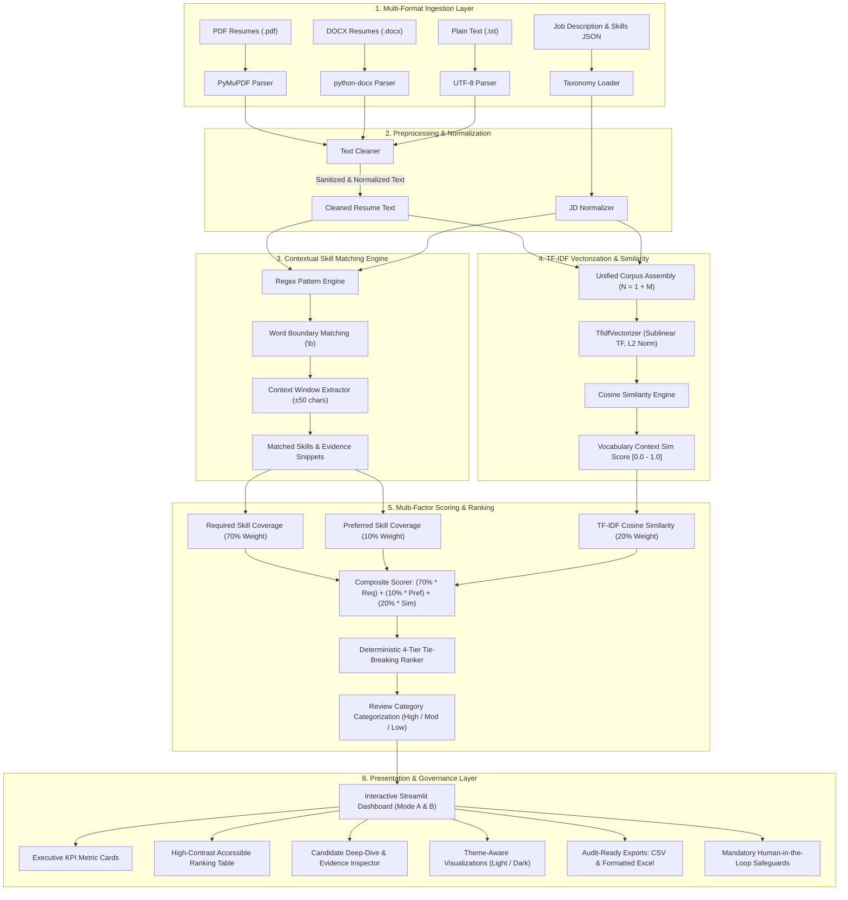

# System Architecture

## Automated Resume Screening Tool
**Author:** Akash Das  
**Domain:** Natural Language Processing (NLP) & Recruitment Analytics  
**Benchmark Role:** Junior Data Analyst  

---

## 1. System Overview

The **Automated Resume Screening Tool** is a production-grade, explainable, and privacy-conscious Natural Language Processing pipeline designed to evaluate, score, and rank resumes against benchmark job descriptions. 

Unlike opaque "black-box" deep learning classifiers, this system prioritizes **mathematical transparency, deterministic reproducibility, recruiter auditability, and candidate privacy**. Every score is directly traceable to explicit textual evidence, keyword detections, and statistical cosine similarity metrics.

---

## 2. Core Architectural Layers

### 2.1 Multi-Format Ingestion Layer (`src/resume_parser.py`)
- **Format Support:** Ingests documents across standard industry formats: Adobe PDF (`.pdf`), Microsoft Word (`.docx`), and Plain Text (`.txt`).
- **Engine Backends:**
  - PDF: Powered by `PyMuPDF` (`fitz`), extracting structured text stream while discarding binary artifacts, images, and font encoding anomalies.
  - DOCX: Powered by `python-docx`, iterating over document paragraphs and table cells to capture all textual content.
  - TXT: Direct multi-encoding stream decoder with UTF-8 primary and Latin-1 fallback.
- **Fail-Safe Isolation:** In-memory stream handling via `io.BytesIO`. Files with 0-byte sizes, unsupported extensions, or corrupt byte structures are safely caught, logged, and isolated without halting batch evaluation.

### 2.2 Text Preprocessing & Cleaning Layer (`src/text_cleaner.py`)
- **Noise Reduction:** Strips email headers, URL hyperlinks, unprintable control characters, and extraneous punctuation while preserving semantic paragraph boundaries.
- **Technical Token Preservation:** Custom token-protection rules ensure domain-critical technical terms (e.g., `C++`, `C#`, `.NET`, `CI/CD`, `Node.js`, `scikit-learn`, `Power BI`) are not corrupted by aggressive punctuation stripping.
- **Case & Space Normalization:** Converts text to lowercase for comparison while preserving original capitalization in presentation text; collapses multiple spaces, tabs, and carriage returns into single whitespace.

### 2.3 Contextual Skill Extraction Engine (`src/skill_extractor.py`)
- **Taxonomy Driven:** Evaluates resumes against a dual-tier taxonomy loaded from `junior_data_analyst_requirements.json`:
  - **Mandatory Required Skills (6):** Python, SQL, Pandas, Data Cleaning, Data Analysis, Basic Statistics.
  - **Secondary Preferred Skills (6):** NumPy, Scikit-learn, Machine Learning, Power BI, Tableau, Excel.
- **Word Boundary Regex:** Utilizes regex boundary matching (`\b`) to prevent false-positive substring matches (e.g., ensuring "java" does not match inside "javascript", or "c" inside "cat").
- **Evidence Extraction:** Extracts a contextual text window ($\pm 50$ characters around each detection) to provide recruiters with verifiable proof of how the skill was utilized in candidate projects or work experience.

### 2.4 Vectorization & Semantic Similarity Engine (`src/similarity.py`)
- **Unified Corpus Construction:** Vectorizes the job description and all candidate resumes within a single joint vocabulary ($N = 11$ for benchmark cohort, $N = 1 + M$ for uploaded resumes). This prevents vocabulary skew and guarantees identical IDF (Inverse Document Frequency) weights across all evaluated candidates in a batch.
- **Scikit-Learn TF-IDF Configuration:**
  - N-gram Range: Unigrams and bigrams `(1, 2)` to capture compound phrases like "data analysis" and "machine learning".
  - Sublinear TF Scaling: Replaces raw term frequency $tf$ with $1 + \log(tf)$ to prevent candidates with repetitive keyword stuffing from artificially dominating the score.
  - Normalization: L2 Euclidean vector normalization ensures document length does not penalize concise, high-density resumes.
- **Cosine Similarity:** Computes inner product between L2-normalized candidate vectors and the benchmark job description vector:
  $$\text{Cosine Similarity}(\vec{u}, \vec{v}) = \frac{\vec{u} \cdot \vec{v}}{\|\vec{u}\|_2 \|\vec{v}\|_2}$$

### 2.5 Multi-Factor Scoring Engine (`src/scoring.py`)
- **Transparent Formula:** Matches candidates across three clearly weighted dimensions:
  $$\text{Composite Score} = (70.0 \times \text{ReqCov}) + (10.0 \times \text{PrefCov}) + (20.0 \times \text{CosineSim})$$
- **Weighting Rationale:**
  - **70% Mandatory Skills:** Core technical qualifications non-negotiable for job performance.
  - **10% Preferred Skills:** Value-add competencies that distinguish advanced candidates.
  - **20% Contextual Similarity:** Holistic domain alignment, terminology density, and technical vocabulary context.
- **Zero Hallucination:** Scores are bounded in the range $[0.0, 100.0]$ and computed deterministically with full floating-point precision.

### 2.6 Deterministic 4-Tier Tie-Breaking Ranker (`src/ranking.py`)
To ensure total fairness and eliminate arbitrary sorting, candidates are ranked using a 4-tier tie-breaking hierarchy:
1. **Primary:** Descending Composite Match Score.
2. **Secondary:** Higher Mandatory Required Skill Coverage (70% component).
3. **Tertiary:** Higher Secondary Preferred Skill Coverage (10% component).
4. **Quaternary:** Higher TF-IDF Cosine Similarity (20% component).
5. **Final Tie-Break:** Ascending Candidate ID (lexicographical stability).

### 2.7 Review Category Classification
Candidates are assigned to transparent administrative review tiers:
-  **High Match:** $\text{Composite Score} \ge 70.0$ (Strong fit across required and preferred criteria).
-  **Moderate Match:** $40.0 \le \text{Composite Score} < 70.0$ (Solid foundational skills, minor gaps).
-  **Low Match:** $\text{Composite Score} < 40.0$ (Significant skill or domain misalignment).

> [!IMPORTANT]
> **Mandatory Human-in-the-Loop Governance:** The "Low Match" category serves strictly as an organizational triage flag, **NEVER as an automated candidate rejection**. Final hiring decisions strictly require human recruiter review.

---

## 3. Presentation & User Experience Layer

### 3.1 Streamlit Dashboard Architecture (`app.py`)
- **Two Execution Modes:**
  - **Mode A (Benchmark Cohort):** Single-click evaluation of the 10 pre-configured synthetic sample resumes matching approved Phase 9 benchmark scores.
  - **Mode B (Custom Uploads):** Drag-and-drop uploader accepting multiple PDF, DOCX, and TXT resumes with real-time error isolation.
- **Theme-Aware UI Manager (`src/theme_manager.py`):**
  - Instant toggle between Dark Mode (Default) and Light Mode via session state.
  - Strict WCAG 2.2 AA contrast compliance (minimum 4.5:1, up to 16.5:1).
  - Custom HTML components for KPI metric cards, review badges, and candidate ranking tables.
- **Dynamic Chart Suite (`src/dashboard_charts.py`):**
  - Six Matplotlib charts dynamically adjusting backgrounds, tick labels, axes, and grids to match active themes.
  - Agg non-interactive backend with strict memory cleanup (`plt.close()`).

### 3.2 Reporting & Audit Subsystem (`src/report_generator.py`)
- **CSV Export:** Standard UTF-8 comma-separated file with full metrics, timestamps, and ranking positions.
- **Excel Export:** Multi-tab formatted spreadsheet powered by `openpyxl`:
  - `Candidate Rankings`: Primary audit table with custom column widths, zebra striping, and conditional formatting.
  - `Cohort Summary`: Executive statistics (mean, median, standard deviation, category counts).
  - `Skill Breakdown`: Granular candidate-by-skill detection matrix.
  - `Metadata & Parameters`: System configuration, weights, and run timestamps.
