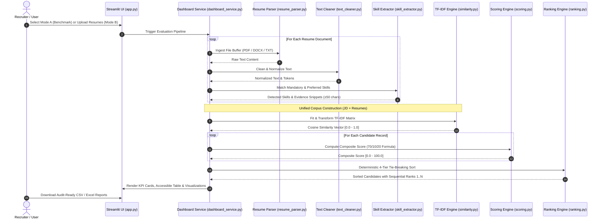
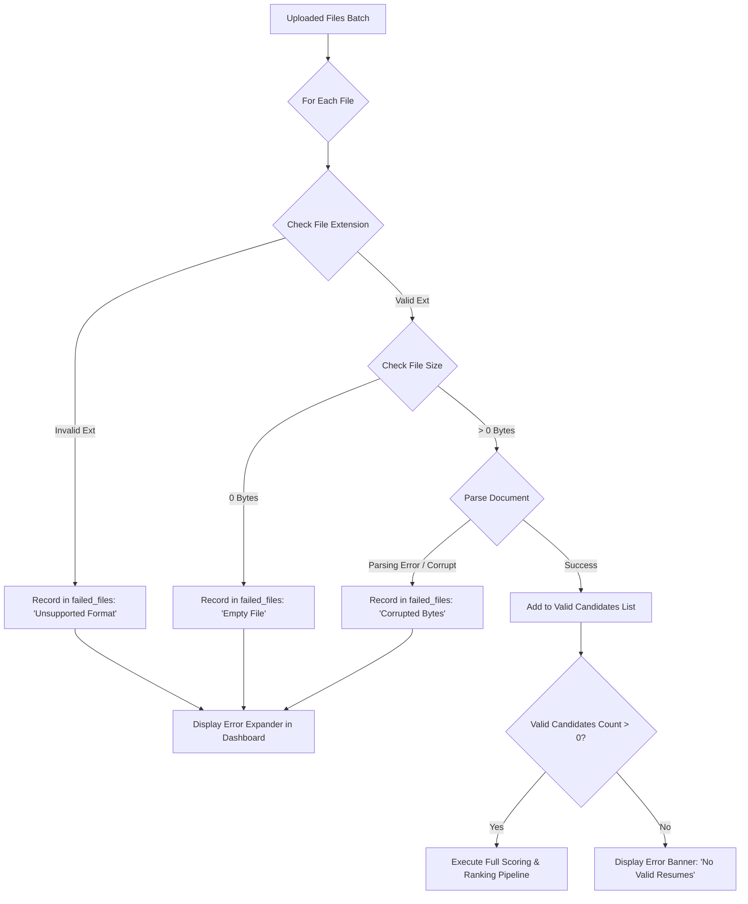

# Data Flow & Pipeline Architecture

## Automated Resume Screening Tool
**Author:** Akash Das  
**Workspace:** `D:\Projects\Python\Automated Resume Screening Tool`  

---

## 1. End-to-End Pipeline Overview

The screening pipeline processes resume documents through seven sequential, deterministic stages. Every transformation preserves mathematical traceability, guaranteeing that the final composite score and rank position can be audited directly back to source text snippets.

---

## 2. Detailed Data Transformation Stages

### Stage 1: Document Ingestion & Text Extraction
- **Input:** Raw binary file bytes or filesystem paths (`.pdf`, `.docx`, `.txt`).
- **Processing:**
  - File extension is validated against whitelist: `[".pdf", ".docx", ".txt"]`.
  - Empty files ($0$ bytes) are detected immediately and excluded with a descriptive error.
  - PyMuPDF opens PDF buffers; python-docx opens DOCX buffers; UTF-8 decoder reads TXT buffers.
  - Corrupted byte streams trigger structured `FileExtractionError` without crashing the batch.
- **Output:** Raw document string containing full textual content, or error descriptor in `failed_files`.

### Stage 2: Text Cleaning & Normalization
- **Input:** Raw document text.
- **Processing:**
  - Case folding to lowercase for semantic comparisons (while preserving original case for snippet evidence).
  - Normalization of line breaks (`\r\n` $\rightarrow$ `\n`) and stripping of consecutive blank lines.
  - Collapsing of redundant tabs and consecutive spaces into single whitespace.
  - Technical token protection: Special characters in terms such as `C++`, `C#`, `.NET`, `CI/CD`, and `Node.js` are preserved via lookahead regexes.
- **Output:** Cleaned text string optimized for tokenization and regex matching.

### Stage 3: Contextual Skill Matching
- **Input:** Cleaned resume text and benchmark taxonomy JSON (`junior_data_analyst_requirements.json`).
- **Processing:**
  - Two skill dictionaries are evaluated:
    - **Required Skills (6):** `Python`, `SQL`, `Pandas`, `Data Cleaning`, `Data Analysis`, `Basic Statistics`.
    - **Preferred Skills (6):** `NumPy`, `Scikit-learn`, `Machine Learning`, `Power BI`, `Tableau`, `Excel`.
  - Word boundary patterns (`\b<skill>\b`) are compiled and executed case-insensitively.
  - For each detected skill, a contextual snippet ($\pm 50$ characters around the match) is captured and sanitized.
- **Output:**
  - `matched_required_skills`: List of detected mandatory skills.
  - `matched_preferred_skills`: List of detected preferred skills.
  - `required_coverage`: Float ratio $\frac{|\text{Matched Required}|}{6.0}$.
  - `preferred_coverage`: Float ratio $\frac{|\text{Matched Preferred}|}{6.0}$.
  - `contextual_evidence`: List of tuples `(skill_name, snippet, importance)`.

### Stage 4: Unified TF-IDF Vectorization & Cosine Similarity
- **Input:** Corpus list of size $N = 1 + M$ consisting of the normalized Job Description at index 0, followed by the $M$ candidate resume texts.
- **Processing:**
  - Single vectorizer fit: `TfidfVectorizer(ngram_range=(1, 2), sublinear_tf=True, norm="l2")`.
  - Transforming all documents simultaneously ensures identical IDF weighting across the entire candidate cohort.
  - Cosine similarity between candidate vector $\vec{c}_i$ and JD vector $\vec{jd}$ is calculated via dot product:
    $$\text{sim}_i = \sum_{j=1}^{V} \vec{c}_{i, j} \times \vec{jd}_{j}$$
- **Output:** Normalized cosine similarity float $\in [0.0, 1.0]$.

### Stage 5: Multi-Factor Composite Scoring
- **Input:** `required_coverage`, `preferred_coverage`, and `cosine_similarity`.
- **Processing:**
  - Applies authoritative weighted linear model:
    $$\text{Score} = (70.0 \times \text{required\_coverage}) + (10.0 \times \text{preferred\_coverage}) + (20.0 \times \text{cosine\_similarity})$$
  - Bounded strictly within $[0.0, 100.0]$ with 16-decimal double precision.
- **Output:** `composite_score` (float).

### Stage 6: Deterministic 4-Tier Tie-Breaking Ranking
- **Input:** List of unranked candidate evaluation records.
- **Processing:**
  - Sorted using Python's deterministic Timsort key:
    $$\text{key} = \Big(-\text{composite\_score},\; -\text{required\_coverage},\; -\text{preferred\_coverage},\; -\text{cosine\_similarity},\; \text{candidate\_id}\Big)$$
  - Sequential ranks $1, 2, \dots, N$ are assigned to sorted candidates.
  - Review tier assigned:
    - $\text{Score} \ge 70.0 \rightarrow$ **High Match**
    - $40.0 \le \text{Score} < 70.0 \rightarrow$ **Moderate Match**
    - $\text{Score} < 40.0 \rightarrow$ **Low Match**
- **Output:** Ordered candidate records with sequential ranks and category tags.

### Stage 7: Presentation, Visualization & Export
- **Input:** Ordered candidate records and cohort summary metrics.
- **Processing:**
  - Streamlit UI renders 6 executive KPI cards and the accessible HTML ranking table.
  - Matplotlib Agg backend renders 6 theme-aware charts into in-memory figures.
  - `report_generator.py` exports in-memory CSV and multi-sheet formatted Excel workbooks.
- **Output:** Interactive visual dashboard and downloadable audit-ready reports.

---

## 3. Resilient Error Handling & Batch Isolation

The pipeline guarantees that bad, corrupt, or unsupported files **never interrupt or corrupt the evaluation of valid resumes** within the same batch.
