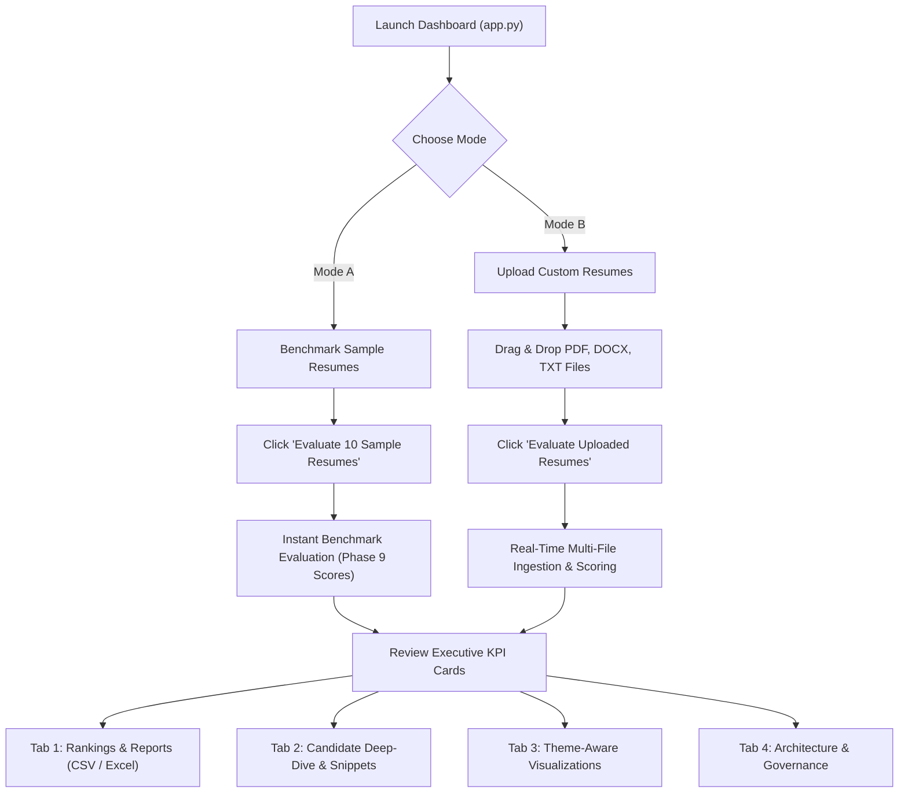

# User Guide & Operations Manual

## Automated Resume Screening Tool
**Author:** Akash Das  
**Application Entry Point:** `app.py`  
**Workspace:** `D:\Projects\Python\Automated Resume Screening Tool`  

---

## 1. Introduction

The **Automated Resume Screening Tool** is an interactive web-based decision-support system built with **Streamlit**. It assists recruiters, talent acquisition professionals, and hiring managers by automating the parsing, skill matching, and objective scoring of candidate resumes against defined job benchmarks.

---

## 2. System Requirements & Installation

### 2.1 Prerequisites
- **Operating System:** Windows 10/11, macOS, or Linux.
- **Python Version:** Python 3.10 or 3.11 (tested on Python 3.11.0).
- **Web Browser:** Google Chrome, Microsoft Edge, Mozilla Firefox, or Safari.

### 2.2 Environment Setup & Installation

1. **Open a terminal** in the workspace root directory:
   ```powershell
   cd "D:\Projects\Python\Automated Resume Screening Tool"
   ```

2. **Create a virtual environment:**
   ```powershell
   python -m venv .venv
   ```

3. **Activate the virtual environment:**
   - *Windows (PowerShell):*
     ```powershell
     .\.venv\Scripts\Activate.ps1
     ```
   - *Windows (Command Prompt):*
     ```cmd
     .\.venv\Scripts\activate.bat
     ```
   - *Linux / macOS:*
     ```bash
     source .venv/bin/activate
     ```

4. **Install required dependencies:**
   ```powershell
   python -m pip install --upgrade pip
   pip install -r requirements.txt
   ```

---

## 3. Launching the Application

Start the Streamlit dashboard server:

```powershell
streamlit run app.py
```

Upon startup, Streamlit will display the local network URL in your terminal:
```text
  You can now view your Streamlit app in your browser.

  Local URL: http://localhost:8501
  Network URL: http://192.168.x.x:8501
```

Open your web browser and navigate to `http://localhost:8501`.

---

## 4. Dashboard Modes & User Workflows

The dashboard provides two dedicated evaluation modes accessible via tabs at the top of the interface:



### 4.1 Mode A: Benchmark Sample Resumes
- **Purpose:** Evaluate the 10 pre-configured synthetic sample resumes (`CAND-001` through `CAND-010`) against the Junior Data Analyst job description.
- **Workflow:**
  1. Click the **" Mode A: Benchmark Sample Resumes"** tab.
  2. Click the blue **" Evaluate 10 Sample Resumes"** button.
  3. The pipeline immediately loads, parses, and scores all 10 candidates.
  4. Authoritative benchmark scores and ranks appear instantly across all tabs.

### 4.2 Mode B: Upload Custom Resumes
- **Purpose:** Evaluate custom candidate resumes uploaded directly from your computer.
- **Workflow:**
  1. Click the **" Mode B: Upload Custom Resumes"** tab.
  2. Drag and drop multiple resume files into the uploader zone or click "Browse files".
  3. **Supported Formats:** `.pdf`, `.docx`, and `.txt`.
  4. Click the green **" Evaluate Uploaded Resumes"** button.
  5. The system performs real-time batch parsing, builds a unified TF-IDF corpus ($N = 1 + M$), and ranks all valid resumes.
  6. **Resilient Error Isolation:** If any uploaded file is empty ($0$ bytes) or corrupted, the system isolates it into a collapsible warning box (`⚠️ Processing Failures`) while successfully evaluating all valid resumes.

---

## 5. Dashboard Features & Navigation

### 5.1 Dynamic Theme Switching
- Locate the theme toggle button in the top-right header:
  - Click **"☀️ Switch to Light Mode"** to switch to the crisp Clean Slate palette.
  - Click **" Switch to Dark Mode"** to switch to the Deep Midnight palette.
- **State Preservation:** Switching themes does **not** reset candidate results, clear uploaded files, or trigger pipeline recomputation.

### 5.2 Executive KPI Metric Cards
Six high-contrast metric cards summarize the evaluated cohort at a glance:
1. **Total Submitted:** Total count of resume files provided.
2. **Successfully Scored:** Count of candidates successfully parsed and ranked.
3. **Failed / Errors:** Count of rejected or corrupt files ($0$ in normal runs).
4. **Top Match Score:** Highest composite score achieved in the cohort.
5. **Cohort Mean Score:** Average composite score across all valid candidates.
6. **Review Tiers:** Distribution summary (e.g., `3 Mod / 7 Low`).

### 5.3 Tab 1: Candidate Rankings & Audit Reports
- **Accessible Candidate Ranking Table:** Displays sequential Rank, Candidate ID, Composite Score, Required Coverage, Preferred Coverage, TF-IDF Cosine Similarity, and Review Category badge.
- **Interactive Dataframe Expander:** Allows sorting, column filtering, and full-text keyword searching.
- **Audit-Ready Report Downloads:**
  - **Download Screening Report (CSV):** Click to download a comma-separated UTF-8 audit file.
  - **Download Formatted Screening Report (Excel):** Click to download a multi-tab formatted `.xlsx` workbook featuring custom column widths, zebra striping, cohort statistics, and skill breakdown matrices.

### 5.4 Tab 2: Candidate Deep-Dive & Skill Evidence
- **Candidate Selector:** Choose any evaluated candidate from the dropdown.
- **Metric Overview:** Displays the candidate's rank, composite score, and review badge.
- **Categorized Skill Detection Badges:**
  -  **Matched Required Skills:** Green badges indicating detected mandatory skills.
  -  **Missing Required Skills:** Red badges highlighting missing mandatory skills.
  -  **Matched Preferred Skills:** Purple badges showing secondary competencies.
- **Contextual Evidence Snippets:** Expand the **" View Contextual Evidence Snippets"** accordion to review the exact sentences ($\pm 50$ characters) extracted from the resume showing where and how each skill was mentioned.
- **Sanitized Resume Text Preview:** Review the anonymized, cleaned resume text used by the scoring engine.

### 5.5 Tab 3: Analytical Visualizations
Displays six responsive, theme-aware Matplotlib charts:
1. **Candidate Score Comparison:** Horizontal bar chart sorted by rank with value callouts.
2. **Score Distribution:** Histogram with mean and median indicators.
3. **Skill Coverage Comparison:** Grouped bar chart comparing required vs preferred coverage.
4. **Cosine Similarity vs Score:** Correlation scatter plot showing vocabulary alignment.
5. **Review Category Distribution:** High-contrast donut chart of review tiers.
6. **Required Skill Frequency:** Horizontal frequency chart showing cohort detection counts for mandatory skills.

### 5.6 Tab 4: System Architecture & Governance
Provides recruiters and auditors with complete transparency regarding system design, mathematical formulas, scoring weights, and ethical safeguards.

---

## 6. Ethical Governance & Mandatory Human-in-the-Loop Policy

```text
================================================================================
                    ETHICAL RECRUITMENT SAFEGUARD NOTICE
================================================================================
The Automated Resume Screening Tool is strictly designed as an EDUCATIONAL 
DECISION-SUPPORT PROTOTYPE.

1. Scores generated reflect text-relevance indicators against specific benchmark
   keywords; they do NOT measure human intelligence, competence, or potential.
2. The "Low Match" tier serves solely as an organizational review priority flag,
   NEVER as an automated candidate disqualification or rejection mechanism.
3. Human recruiters must review candidate profiles before making any interview,
   advancement, or hiring decision.
================================================================================
```
